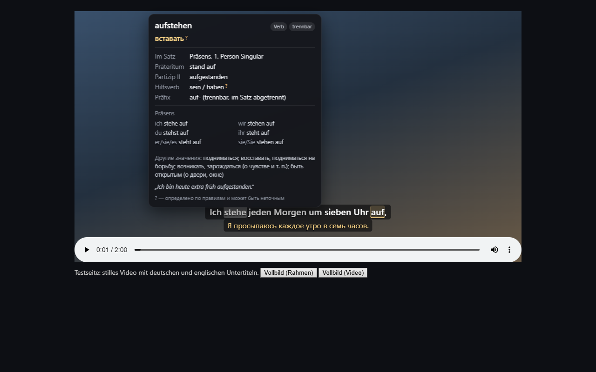

# Mitlesen

Расширение для Opera (и других браузеров на Chromium, Manifest V3). Показывает под видео немецкие субтитры и русский перевод. Любое немецкое слово можно навести или нажать: откроется карточка с переводом в этом предложении, родом и множественным числом существительного, падежом, формами глагола, отделяемой приставкой.

Перевод делается на вашем компьютере. По умолчанию модель OPUS-MT работает прямо в браузере, без серверов и ключей. Если нужно быстрее или точнее, можно подключить локальный сервис Mitlesen (та же модель на CTranslate2, есть GPU) или Ollama.



## Что умеет

- Работает на всех сайтах сразу, ничего включать не нужно.
- YouTube: ручные и автоматические немецкие субтитры, переход между видео без перезагрузки, реклама, смена дорожки в плеере.
- Netflix: немецкие субтитры берутся из файла, который плеер получает вместе со списком дорожек, поэтому перевод идёт наперёд, как на YouTube. Если файл не загрузился, строки читаются с экрана.
- Любой другой сайт с `<video>`: стандартные дорожки `<track>` (WebVTT) или субтитры, которые плеер рисует текстом на странице (так делают Prime Video, Disney+, Max, Vimeo, video.js, JW Player и большинство других). Во втором случае строка появляется вместе с субтитром сайта, без перевода наперёд. Субтитры на другом языке расширение не трогает.
- Две строки: немецкая и русская. Размер, цвета, фон, положение, расстояние между строками настраиваются; любую строку можно скрыть.
- Фрагменты одного предложения, разбитые на несколько титров, переводятся целиком: «Ich habe gestern Abend meinen alten Freund, / den ich seit Jahren nicht gesehen hatte…» получает один связный перевод.
- Следующие строки переводятся заранее. В тестах перевод появлялся одновременно с немецкой строкой.
- Отделяемые приставки: в «Ich stehe jeden Morgen um sieben Uhr auf.» слова «stehe» и «auf» подсвечиваются вместе, карточка показывает *aufstehen*, *stand auf*, *aufgestanden*, *ist*.
- Если факт не выводится надёжно, карточка помечает его как предположение, а не выдаёт за правду.
- Кэш переводов и разборов в IndexedDB: повторный просмотр не нагружает модель.

Где не работает и почему, описано в [RISKS_AND_LIMITATIONS.md](RISKS_AND_LIMITATIONS.md). Коротко: субтитры, которые сайт рисует картинкой (на Netflix так устроены, например, японские), прочитать нельзя. DRM защищает видеопоток, а не субтитры: расширение читает только текст субтитров и видео не трогает.

## Установка в Opera

Нужен собранный каталог `dist` (сборка описана ниже) или распакованный архив: `mitlesen-0.1.0.zip` (283 МБ, с моделью) или `mitlesen-0.1.0-lite.zip` (18 МБ, без модели, только локальный режим). Архивы и модель в git не входят из-за размера; их делает `npm run package`.

1. Откройте `opera://extensions`.
2. Включите «Режим разработчика» справа вверху.
3. Нажмите «Загрузить распакованное расширение» и выберите папку `dist` (или распакованный архив).
4. Откройте видео с немецкими субтитрами (YouTube, Netflix или любой другой сайт). Первая загрузка модели занимает 20–30 секунд, потом перевод идёт без задержек.

На Netflix выберите в плеере немецкие субтитры, если фильм их предлагает. Вкладки, открытые до установки, нужно обновить.

В Opera GX то же самое: `opera://extensions`. В Chrome, Edge и Яндекс Браузере: `chrome://extensions`, `edge://extensions`, `browser://extensions`. Firefox не поддерживается: у него свой формат фоновых скриптов, нужна отдельная сборка.

## Режимы перевода

| Режим | Что нужно | Скорость (среднее на предложение) | Качество, chrF |
|---|---|---|---|
| В браузере (по умолчанию) | ничего | ≈0,9 с в Opera, модель грузится 20–30 с | 60,0 |
| Сервис Mitlesen, CPU | Python 3.10+ | 160 мс | 63,1 |
| Сервис Mitlesen, GPU | NVIDIA + CUDA 12 библиотеки | 66 мс | 63,0 |
| Ollama, qwen3:4b-instruct | Ollama, 4 ГБ видеопамяти | 557 мс (только на GPU) | 58,2 |

Замеры на 159 предложениях, ноутбук i5-9300H + GTX 1650 Max-Q 4 ГБ. Подробности и сравнение по категориям: [MODEL_COMPARISON.md](MODEL_COMPARISON.md).

Режим переключается в окне расширения, раздел «Перевод»: «В браузере» или «Локальный сервис», и ниже, в «Чем переводить», сервис Mitlesen или Ollama. Если локальный сервис не отвечает, перевод переходит на модель в браузере, и окно расширения показывает причину.

### Сервис Mitlesen (рекомендуется для локального режима)

```powershell
cd local-service
powershell -ExecutionPolicy Bypass -File setup.ps1
```

Скрипт создаёт `.venv`, ставит `ctranslate2`, `sentencepiece`, `spacy`, немецкую модель spaCy и скачивает модель перевода (242 МБ, проверяется по SHA-256). Запуск:

```powershell
local-service\start.bat
```

Сервис слушает только `127.0.0.1:8765` и отвечает только расширениям браузера (проверяются заголовки Host и Origin). Помимо перевода он отдаёт разбор spaCy, который уточняет грамматику в карточках.

GPU: сервису нужна `cublas64_12.dll`. Если стоит Ollama, можно взять её копию из папки установки Ollama, `lib\ollama\cuda_v12` (по умолчанию Ollama ставится в `%LOCALAPPDATA%\Programs\Ollama`):

```powershell
set MITLESEN_CUDA_LIB_DIR=%LOCALAPPDATA%\Programs\Ollama\lib\ollama\cuda_v12
local-service\start.bat
```

Если библиотеки нет, сервис сам переходит на CPU и пишет причину в `/health`.

### Ollama

1. Установите Ollama с ollama.com.
2. Скачайте модель: `ollama pull qwen3:4b-instruct`. Обычная `qwen3:4b` думает перед ответом (≈15 с на строку) и для субтитров не годится.
3. В окне расширения: «Локальный сервис» → «Чем переводить» → «Ollama». Адрес по умолчанию `http://127.0.0.1:11434`.
4. На видеокарте с 4 ГБ включите «Вся модель на видеокарте». Без этого Ollama делит модель между GPU и CPU и выдаёт 6,5 токена/с вместо 37.

Ollama отклоняет запросы с заголовком `Origin` от расширений (ответ 403). Mitlesen снимает этот заголовок правилом `declarativeNetRequest`, только для своих запросов и только к адресу на `127.0.0.1`/`localhost`. Менять `OLLAMA_ORIGINS` не нужно.

Пока Ollama думает, на экране показывается черновик от OPUS-MT, потом он заменяется.

## Сборка из исходников

Нужны Node.js 24 и npm. Python нужен только для модели и локального сервиса.

```powershell
npm ci
npm run typecheck
npm test
npm run build            # dist/ с моделью, если она есть в models/browser
npm run package          # release/mitlesen-<версия>.zip
node build.mjs --no-model --zip   # облегчённая сборка без модели (только локальный режим)
```

### Модель для браузера

Готовые ONNX-файлы не лежат в репозитории: вместе они весят ≈350 МБ, а GitHub не принимает файлы больше 100 МБ. Их делает скрипт:

```powershell
python -m venv .venv-export
.venv-export\Scripts\pip install -r tools\model\requirements.txt
huggingface-cli download Helsinki-NLP/opus-mt-tc-big-de-zle --local-dir C:\mt\src
.venv-export\Scripts\python tools\model\export_onnx.py --src C:\mt\src --work C:\mt\work --out models\browser\opus-mt-tc-big-de-zle
```

Пути `--src` и `--work` должны быть латиницей: SentencePiece и экспортёр ONNX на Windows не открывают файлы с кириллицей в пути. Скрипт проверен на Python 3.14; для optimum 2.1 на этой версии в нём есть заплатка (см. `patch_optimum_for_py314`).

### Словарь

Готовый словарь лежит в `data/dict` (33 МБ, 141 399 статей). Пересобрать:

```powershell
npm run dict:fetch    # выгрузки Викисловаря с kaikki.org и частотный список, ≈405 МБ после сжатия
npm run dict:build    # пишет data/dict
```

## Тесты

```powershell
npm test                    # 72 юнит-теста: очередь перевода, кэш, разбор фраз, грамматика, форматы субтитров, Netflix
npm run test:e2e            # браузерные сценарии в Opera GX (или Chrome), около 10 минут
npm run eval:grammar        # точность грамматики по 132 случаям
node tests/eval/grammar-eval.mjs --set heldout   # 44 случая, на которых правила не подгонялись
npm run eval:translation    # таблица chrF по сохранённым прогонам
```

Что проверяется и какие получились цифры: [TESTING.md](TESTING.md).

## Если что-то не работает

| Что видно | Причина и что делать |
|---|---|
| «загружается модель перевода…» держится дольше минуты | Модель (≈350 МБ) читается с медленного диска. Положите `dist` на SSD. Процент загрузки виден в окне расширения, раздел «Данные и диагностика». |
| «YouTube ответил на запрос субтитров пустым файлом…» | Так бывает при блокировщиках рекламы и в браузере под автоматизацией. Включите субтитры кнопкой плеера или обновите страницу. |
| «Немецкой дорожки нет. Доступны: …» | У видео нет немецких субтитров, ни ручных, ни автоматических. С других языков расширение не переводит. |
| «У видео нет текстовых дорожек, и субтитров на экране пока не видно» | Включите немецкие субтитры в плеере сайта. Как только они появятся на экране текстом, расширение начнёт их читать. |
| На сайте вообще ничего не появляется | Вкладка была открыта до установки расширения: обновите её. Если плеер рисует субтитры картинкой или внутри `<canvas>`, прочитать их нельзя. |
| Netflix: «Немецких субтитров у этого фильма нет» | В вашем регионе у фильма нет немецкой дорожки. Список доступных показан в окне расширения. |
| Netflix: «Немецкие субтитры у этого фильма только картинками» | Netflix отдаёт эту дорожку изображениями, текста в ней нет. |
| «Локальный сервис не отвечает по адресу …» | Не запущен `start.bat` или занят порт 8765. Проверьте `http://127.0.0.1:8765/health`. Пока сервиса нет, переводит модель в браузере. |
| «Ollama отклонила запрос расширения (403)» | Ollama стоит не на `127.0.0.1`/`localhost`, и правило для заголовка Origin не применяется. Задайте на той машине `OLLAMA_ORIGINS=chrome-extension://*`. |
| Ollama переводит очень медленно | Включите «Вся модель на видеокарте» и проверьте, что выбрана `qwen3:4b-instruct`, а не `qwen3:4b`. |

## Документы

- [ARCHITECTURE.md](ARCHITECTURE.md): как устроено расширение, потоки данных.
- [TECH_STACK.md](TECH_STACK.md): библиотеки и почему они.
- [MODEL_COMPARISON.md](MODEL_COMPARISON.md): модели перевода, замеры.
- [TESTING.md](TESTING.md): тесты и результаты.
- [RISKS_AND_LIMITATIONS.md](RISKS_AND_LIMITATIONS.md): что не работает.
- [PRIVACY.md](PRIVACY.md): какие данные куда уходят.
- [DEVELOPMENT_PLAN.md](DEVELOPMENT_PLAN.md): что сделано и что дальше.
- [LICENSES_AND_ATTRIBUTION.md](LICENSES_AND_ATTRIBUTION.md): лицензии модели, словаря, библиотек.

## Лицензия

Код: MIT. Модель OPUS-MT: CC BY 4.0. Словарь собран из Викисловаря: CC BY-SA 4.0. Подробно в [LICENSES_AND_ATTRIBUTION.md](LICENSES_AND_ATTRIBUTION.md).
